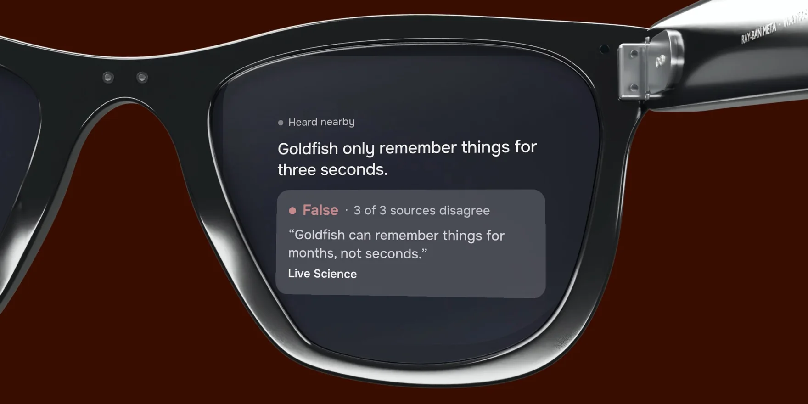
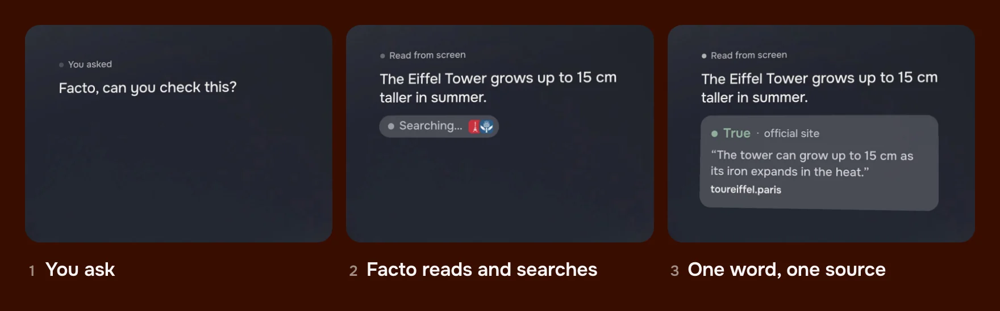
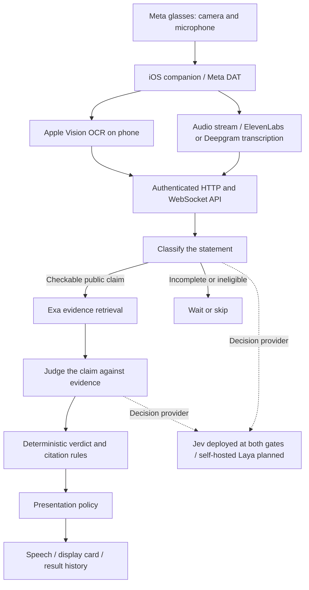

<div align="center">



[Website](https://fact0.eu) · [Demo video](https://youtu.be/VF11rvTQ7kU) · [How it works](#how-it-works) · [Getting started](#getting-started) · [Architecture](#architecture) · [Laya and privacy](#laya-and-privacy)

</div>

## About

Facto is a live fact-checker for Meta glasses, built at Junction 2026 for the Meta challenge. You can use it two ways:

- **It listens.** Start a listening session and Facto picks out the public claims people make around you, then checks them on its own.
- **You ask.** Look at a phone, a screen or a poster and say “Facto, can you check this?”, or tap the check button in the app. The glasses take a photo, your iPhone reads the text and Facto checks the claim.

Every answer is one word and a source: **True**, **False**, **Needs context** or **Unverified**. On Ray-Ban Meta you hear it through the speakers. On Meta Ray-Ban Display it shows up in the right lens, as in the images here. When the evidence is thin, Facto says it can't verify the claim instead of guessing.

Facto is open source. If you have Meta glasses and an iPhone, [Getting started](#getting-started) walks you from a fresh clone to your first check.

**[Watch the demo](https://youtu.be/VF11rvTQ7kU)**

## Why Facto

Checking a claim means pulling out your phone, typing a search and reading through results. Most people skip it and repeat what they heard. Facto runs the search for you and answers while the conversation is still going.

## How it works

<picture>
  <source media="(max-width: 600px)" srcset="docs/images/how-it-works-narrow.webp" />
  
</picture>

1. **Capture.** The iOS companion app talks to the glasses through Meta's Device Access Toolkit. It takes a photo with the glasses camera, or streams audio from a listening session you started.
2. **Read.** Apple Vision pulls the text out of the photo on your iPhone. Audio goes to ElevenLabs, with Deepgram as the fallback, for a transcript.
3. **Decide.** A model decides whether the statement is a checkable public claim. Opinions, personal experiences and half-finished sentences are skipped, or Facto waits for more speech.
4. **Search.** Exa finds sources, and the judgment model weighs the claim against their passages.
5. **Answer.** Fixed rules check the citations and any conflicting sources before the verdict reaches you, spoken or in the lens.

The team measured a **median pipeline latency of about 0.92 s**. That covers the pipeline, not the full trip from camera to answer.

Facto's voice command runs inside the app's own listening session, not through “Hey Meta”. The [iOS guide](apps/ios/README.md) and the [capability record](docs/device-capabilities.md) cover setup and what each pair of glasses supports. The repository also includes a browser preview of the display card in [`apps/glasses`](apps/glasses).

## Architecture

Facto separates capture, evidence gathering, model decisions and presentation. A model’s answer is an input to the system; the evidence and verdict rules determine what reaches the wearer. **The currently deployed pipeline uses Jev for both model decision gates: admission (whether a statement should be checked) and judgment (what the evidence says).** Self-hosted Laya is the planned replacement for both gates.



### Capture and transport

The Swift iOS app connects to Meta’s Device Access Toolkit, manages camera and audio sessions, and coordinates the look-and-check flow. Photos pass through Apple Vision OCR on the phone. Audio is streamed to the backend for transcription. Shared schemas keep the iOS app and TypeScript API aligned.

The backend uses Fastify with authenticated HTTP and WebSocket sessions. Request identities, revisions, cancellation and deadlines keep stale or superseded results from appearing as current answers.

### Classification: should this statement be checked?

The classifier identifies public factual claims and separates them from personal experiences, speculation and statements that need more context. It can admit a claim for checking, wait for more speech, or skip it. This step decides whether to investigate; it does not decide whether the claim is true.

### Retrieval and judgment: what does the evidence say?

Exa retrieves relevant sources. The pipeline normalizes evidence and passes the claim and source passages to the judgment stage. That stage assesses support, contradiction, missing context and uncertainty.

Deterministic policy then checks evidence quality, citations and conflicting sources before assigning an outcome:

- **True** (supported): qualifying evidence supports the claim.
- **False** (contradicted): qualifying evidence contradicts it.
- **Needs context** (misleading): the claim needs context.
- **Unverified** (cannot verify): the available evidence is insufficient.

Timeouts and provider failures remain operational errors, not factual verdicts. Presentation policy separately decides whether to respond, notify or remain silent. **Silence does not mean a claim was verified.**

## Laya and privacy

**Current deployment: Jev handles both the admission and judgment gates. Laya is not used in the deployed pipeline.** We worked on fine-tuning and self-hosting Laya, an open-source model intended to take over both roles, but we could not complete the fine-tuning needed to make it more reliable than Jev. We therefore kept both gates on Jev for this deployment.

**Future direction: move both decision gates to a fully self-hosted Laya solution once its reliability is ready.** Captured statements and conversational context can contain sensitive information. Keeping admission and judgment under our control would reduce reliance on third-party model processing and the associated privacy concerns. [PR #68](https://github.com/erick-dsnk/junction-2026/pull/68) contains the self-hosted Laya provider comparison, and [issue #69](https://github.com/erick-dsnk/junction-2026/issues/69) records provider-specific prompt work. These describe development work, not the deployed provider configuration or a completed replacement for Jev.

Self-hosting Laya would change the privacy boundary for classification and judgment. It would **not** make the whole system local: evidence queries still reach retrieval services, the speech route can use hosted transcription, and optional diagnostics can retain captured material. Apple Vision OCR runs on the phone; enabling remote OCR selection also sends the photo and OCR boxes to the configured vision provider. See the [iOS guide](apps/ios/README.md) for explicit capture controls and diagnostic-log handling.

## Repository map

| Path | Responsibility |
| --- | --- |
| [`apps/ios`](apps/ios) | Swift companion, Meta DAT integration, OCR, audio, speech and display output |
| [`services/api`](services/api) | Sessions, transcription, claim classification, retrieval, judgment and presentation policy |
| [`packages/contracts`](packages/contracts) | Shared schemas and versioned event contracts |
| [`apps/console`](apps/console) | Browser console and evaluation harnesses |
| [`apps/glasses`](apps/glasses) | Fixture-based display HUD and visual inspection tools |
| [`apps/landing`](apps/landing) | Product landing page, glasses imagery and animations |
| [`fixtures`](fixtures) | Test cases, evaluation datasets and recorded evidence |
| [`docs`](docs) | Device records, implementation notes and evaluation methodology |

## Getting started

Use Node.js **22.12+ within v22, v24, or v26+**, matching the root package’s engine constraint. Native iOS development additionally requires macOS, Xcode, signing and compatible hardware or the SDK’s mock devices.

### Run the backend locally

```sh
npm ci
cp .env.example .env
```

Edit `.env` before starting:

- Set `DEMO_JOIN_CODE` to a secret code of at least eight characters.
- Set `DEMO_JOIN_EXPIRES_AT` to a future absolute ISO timestamp.
- Keep `PIPELINE_MODE=fixture` for local development without provider credentials.

```sh
npm run dev
```

Open [localhost:3000](http://localhost:3000) for the console. Fixture mode uses predefined examples; it does not verify arbitrary real-world claims.

For the current live backend, set `PIPELINE_MODE=live`, `JEV_API_KEY` and `EXA_API_KEY`. Add `ELEVENLABS_API_KEY` for the audio route (or `DEEPGRAM_API_KEY`, the fallback recogniser). For an experimental setup that runs admission on the fine-tuned Laya model, keep `DECISION_PROVIDER=jev` and set `ADMISSION_PROVIDER=laya`, `LAYA_URL` and `LAYA_API_KEY`. This is not the current deployed configuration. Start the separate model server using the [model and serving guide](docs/jev-laya-evaluation.md); `npm run dev` starts only the API. See the [deployment guide](docs/deployment.md) for hosted configuration and [`.env.example`](.env.example) for the variable reference. Keep credentials on the server and out of commits.

### Run the visual previews

```sh
# Display HUD, from the repository root
npm run dev:glasses

# Landing page, in a separate terminal
cd apps/landing
npm install
npm run dev
```

The HUD uses fixtures, not live evidence. Its [guide](apps/glasses/README.md) lists the preview routes. The landing page has its own package and lock file.

### Connect the glasses

Follow the [iOS setup guide](apps/ios/README.md) for Meta AI pairing, Developer Mode, XcodeGen, signing and permissions. Connect the companion to your backend, start a session, and explicitly start listening or request a photo check.

The app uses foreground capture. Connection recovery does not automatically restart an ordinary capture session; the wearer stays in control of starting it again.

## Development

```sh
npm run check          # Lint, TypeScript and backend/shared tests
npm run check:glasses  # Display UI checks
npm run build:glasses  # Display UI production build
```

Native iOS tests require Xcode; instructions live in the [iOS guide](apps/ios/README.md). For deployment, see the [deployment guide](docs/deployment.md). Evaluation results and their limits are documented in [`docs/evaluation.md`](docs/evaluation.md). Fixture tests and provider comparisons do not establish accuracy across everyday use.

Documentation index: [docs/README.md](docs/README.md).

Contribution and review conventions live in [`AGENTS.md`](AGENTS.md) and the [team playbook](docs/PLAYBOOK.md).

## Built at Junction 2026

<table align="center">
  <tr>
    <td align="center" width="200">
      <a href="https://www.linkedin.com/in/eric-tabacaru/"><br /><b>Eric Tabacaru</b></a><br /><sub>LinkedIn</sub>
    </td>
    <td align="center" width="200">
      <a href="https://www.linkedin.com/in/ciprian-nitipir-0885b6343/"><br /><b>Ciprian Nitipir</b></a><br /><sub>LinkedIn</sub>
    </td>
    <td align="center" width="200">
      <a href="https://www.linkedin.com/in/david-vasilescu-3b8a23347/"><br /><b>David Vasilescu</b></a><br /><sub>LinkedIn</sub>
    </td>
  </tr>
</table>

Concept app. Not affiliated with Meta or Ray-Ban.

**A source. In the moment.**
