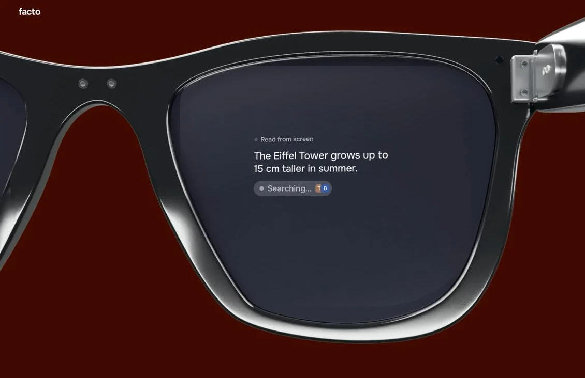
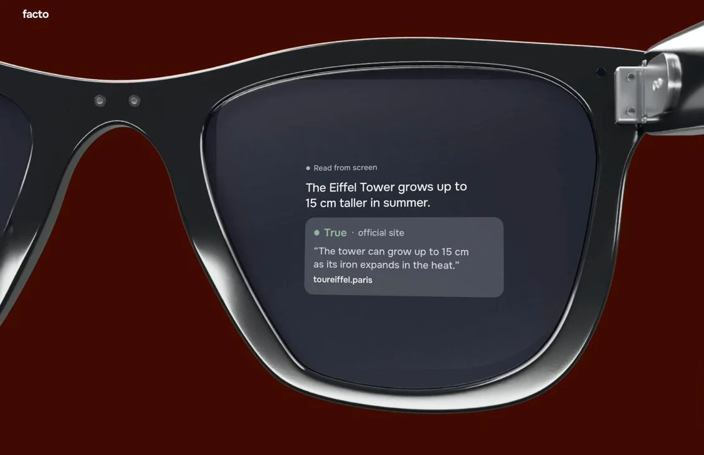
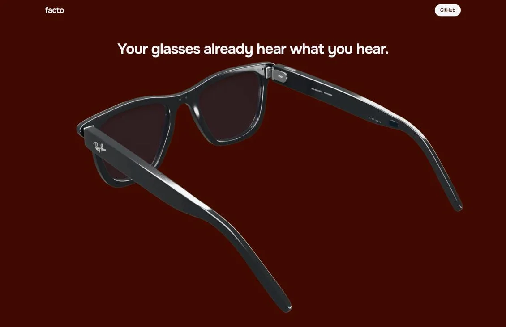
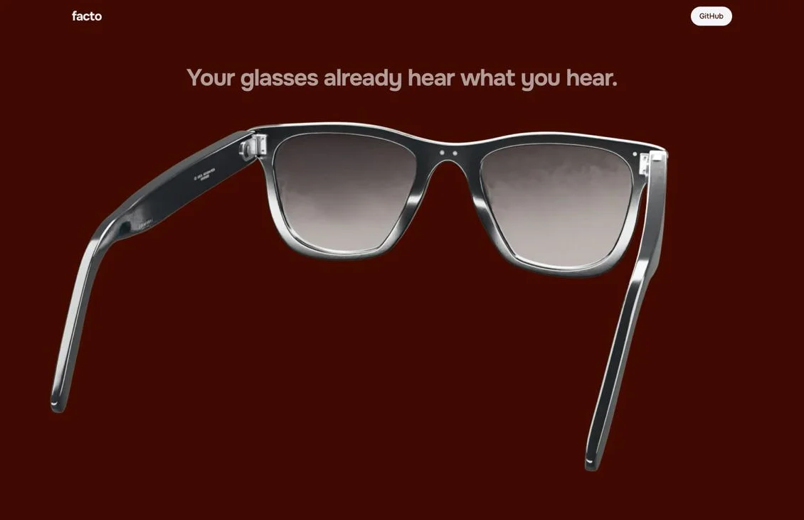
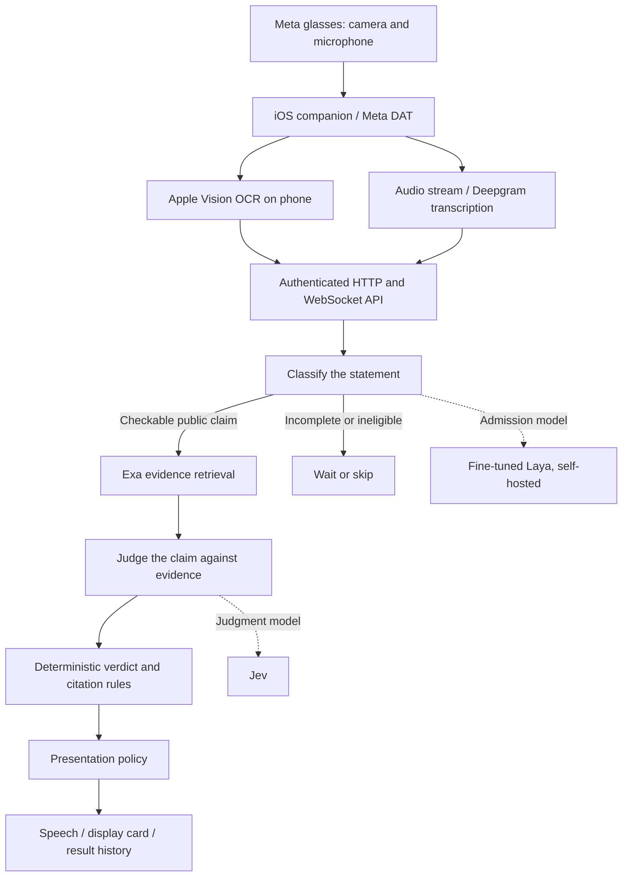

<div align="center">

# facto

### Fact-checking without the effort.

One request. An answer through your Meta glasses.

 
<br />
 

**Look. Ask. Check.**

[Demo video](https://youtu.be/VF11rvTQ7kU) · [Website](https://fact0.eu) · [Getting started](#getting-started) · [Architecture](#architecture) · [Laya and privacy](#laya-and-privacy) · [Development](#development)

</div>

## About

Facto is a live fact-checker for Meta glasses, built at Junction 2026 for the Meta challenge. When someone near you states a fact, or you ask "Facto, can you check this?" while looking at a screen or poster, Facto captures the claim, searches real sources and gives you a one-word verdict with its source: **true**, **false**, **needs context** or **unverified**. You hear it through the speakers, or see it in the right lens on Meta Ray-Ban Display.

It is made of a Swift iOS companion that talks to the glasses through Meta's Device Access Toolkit and reads text on the phone with Apple Vision, and a TypeScript backend. The backend decides whether a statement is worth checking, retrieves evidence with Exa, has a model judge the claim against that evidence, then applies fixed rules for citations and conflicting sources before anything reaches the wearer. When the evidence is thin, Facto says it can't verify the claim instead of guessing.

**[Watch the demo](https://youtu.be/VF11rvTQ7kU)**

## Why facto

People pass on what they believe. Others take it at face value.

Fact-checking takes effort. So it’s easy to skip.

Facto brings live fact-checking to Meta glasses. Look at a claim, request a check, and let the pipeline find the evidence. No typing. No searching. No digging through results.

## One request. Facto takes it from there.

| Step | What happens |
| --- | --- |
| **Capture** | Take a photo of the claim in front of you, or use speech from an active listening session. |
| **Read** | Apple Vision extracts text on the phone; the audio route produces a transcript. |
| **Check** | Identify a checkable public statement, retrieve evidence, and assess what the sources say. |
| **Answer** | Return a short result with supporting sources, through speech or a display card. |

**Hear the answer. See the source.** Speaker-only glasses use spoken output. Display glasses have a visual card for the claim, result and source; the repository also includes a browser-based HUD preview.

The app supports an on-screen check action and a “check this” command during active listening. The intended native “Hey Meta” experience is not the same as the app’s own voice-trigger integration. Device-specific behavior and setup are documented in the [iOS guide](apps/ios/README.md) and [capability record](docs/device-capabilities.md).

The team reports **~0.92s median pipeline latency**. This is a pipeline measurement, not a guarantee for the full camera-to-answer experience.

## Architecture

Facto separates capture, evidence gathering, model decisions and presentation. A model’s answer is an input to the system; the evidence and verdict rules determine what reaches the wearer.



### Capture and transport

The Swift iOS app connects to Meta’s Device Access Toolkit, manages camera and audio sessions, and coordinates the look-and-check flow. Photos pass through Apple Vision OCR on the phone. Audio is streamed to the backend for transcription. Shared schemas keep the iOS app and TypeScript API aligned.

The backend uses Fastify with authenticated HTTP and WebSocket sessions. Request identities, revisions, cancellation and deadlines keep stale or superseded results from appearing as current answers.

### Classification: should this statement be checked?

The classifier identifies public factual claims and separates them from personal experiences, speculation and statements that need more context. It can admit a claim for checking, wait for more speech, or skip it. This step decides whether to investigate; it does not decide whether the claim is true.

### Retrieval and judgment: what does the evidence say?

Exa retrieves relevant sources. The pipeline normalizes evidence and passes the claim and source passages to the judgment stage. That stage assesses support, contradiction, missing context and uncertainty.

Deterministic policy then checks evidence quality, citations and conflicting sources before assigning an outcome:

- **Supported:** qualifying evidence supports the claim.
- **Contradicted:** qualifying evidence contradicts it.
- **Misleading:** the claim needs context.
- **Cannot verify:** the available evidence is insufficient.

Timeouts and provider failures remain operational errors, not factual verdicts. Presentation policy separately decides whether to respond, notify or remain silent. **Silence does not mean a claim was verified.**

## Laya and privacy

**Facto's admission gate runs on Laya, an open-source model we fine-tuned and host ourselves.** It decides whether a statement is a checkable public claim, and whether it touches private data or someone's private life, before anything is searched. Jev judges admitted claims against the evidence. Captured speech can contain sensitive information, so the step that sees every statement runs on infrastructure we control instead of a hosted decision service.

The fine-tuned model is deployed on our backend, so testers using the app go through it. On development validation (595 rows) it scored 89.7% on factual-claim classification, 98.7% on private-data detection and 99.8% on private-life detection. These are development numbers, not a blind test. The training data, the comparison with the original checkpoint and its limits are in [PR #68](https://github.com/erick-dsnk/junction-2026/pull/68), and the weights are published as the [admission-v1 release](https://github.com/erick-dsnk/junction-2026/releases/tag/laya-admission-v1-20261114).

Self-hosting changes the privacy boundary for admission. It does **not** make the whole system local: evidence queries still reach retrieval services, the speech route can use hosted transcription, and optional diagnostics can retain captured material. Apple Vision OCR runs on the phone. See the [iOS guide](apps/ios/README.md) for explicit capture controls and diagnostic-log handling.

## Repository map

| Path | Responsibility |
| --- | --- |
| [`apps/ios`](apps/ios) | Swift companion, Meta DAT integration, OCR, audio, speech and display output |
| [`services/api`](services/api) | Sessions, transcription, claim classification, retrieval, judgment and presentation policy |
| [`packages/contracts`](packages/contracts) | Shared schemas and versioned event contracts |
| [`apps/console`](apps/console) | Browser console and evaluation harnesses |
| [`apps/glasses`](apps/glasses) | Fixture-based display HUD and visual inspection tools |
| [`apps/landing`](apps/landing) | Product landing page, glasses imagery and animations |
| [`fixtures`](fixtures) | Test cases, evaluation datasets and recorded evidence |
| [`docs`](docs) | Device records, implementation notes and evaluation methodology |

## Getting started

Use Node.js **22.12+ within v22, v24, or v26+**, matching the root package’s engine constraint. Native iOS development additionally requires macOS, Xcode, signing and compatible hardware or the SDK’s mock devices.

### Run the backend locally

```sh
npm ci
cp .env.example .env
```

Edit `.env` before starting:

- Set `DEMO_JOIN_CODE` to a secret code of at least eight characters.
- Set `DEMO_JOIN_EXPIRES_AT` to a future absolute ISO timestamp.
- Keep `PIPELINE_MODE=fixture` for local development without provider credentials.

```sh
npm run dev
```

Open [localhost:3000](http://localhost:3000) for the console. Fixture mode uses predefined examples; it does not verify arbitrary real-world claims.

For the current live backend, set `PIPELINE_MODE=live`, `JEV_API_KEY` and `EXA_API_KEY`. Add `ELEVENLABS_API_KEY` for the audio route (or `DEEPGRAM_API_KEY`, the fallback recogniser). To run admission on the fine-tuned Laya model, as the hosted backend does, set `ADMISSION_PROVIDER=laya`, `LAYA_URL` and `LAYA_API_KEY`. See the [deployment guide](docs/deployment.md) for every variable. Keep credentials on the server and out of commits.

### Run the visual previews

```sh
# Display HUD, from the repository root
npm run dev:glasses

# Landing page, in a separate terminal
cd apps/landing
npm install
npm run dev
```

The HUD uses fixtures, not live evidence. Its [guide](apps/glasses/README.md) lists the preview routes. The landing page has its own package and lock file.

### Connect the glasses

Follow the [iOS setup guide](apps/ios/README.md) for Meta AI pairing, Developer Mode, XcodeGen, signing and permissions. Connect the companion to your backend, start a session, and explicitly start listening or request a photo check.

The app uses foreground capture. Connection recovery does not automatically restart an ordinary capture session; the wearer stays in control of starting it again.

## Development

```sh
npm run check          # Lint, TypeScript and backend/shared tests
npm run check:glasses  # Display UI checks
npm run build:glasses  # Display UI production build
```

Native iOS tests require Xcode; instructions live in the [iOS guide](apps/ios/README.md). For deployment, see the [deployment guide](docs/deployment.md). Evaluation results and their limits are documented in [`docs/evaluation.md`](docs/evaluation.md). Fixture tests and provider comparisons do not establish accuracy across everyday use.

Documentation index: [docs/README.md](docs/README.md).

Contribution and review conventions live in [`AGENTS.md`](AGENTS.md) and the [team playbook](docs/PLAYBOOK.md).

## Built at Junction 2026

Eric Tabacaru · David Vasilescu · Ciprian Nitipir

Concept app. Not affiliated with Meta or Ray-Ban.

**A source. In the moment.**
